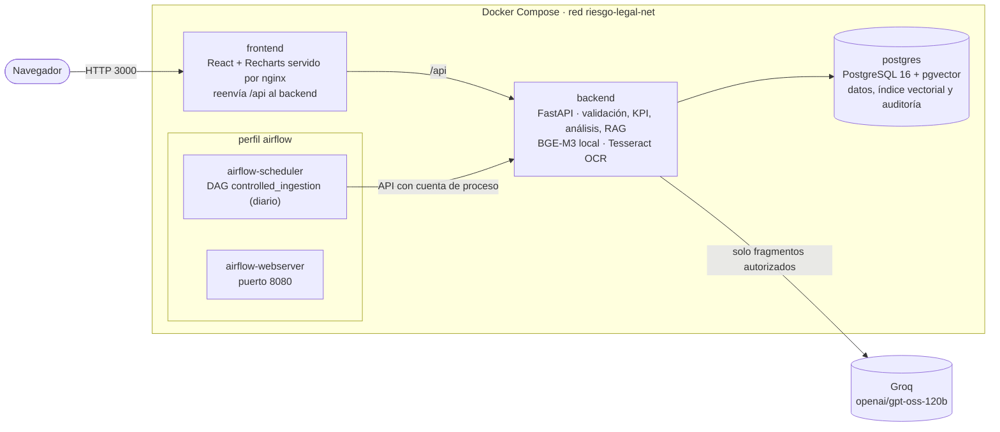
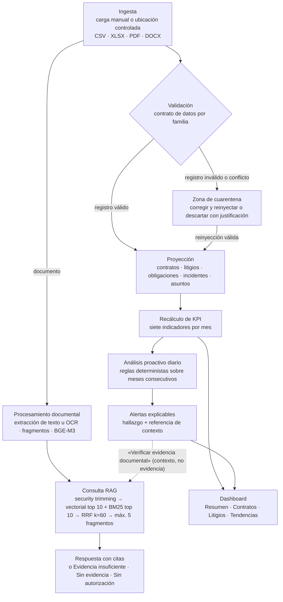

# Arquitectura de Legaltech

Legaltech es el nombre de la aplicación web del **Dashboard de Indicadores de Riesgo Legal**. Este documento resume sus
contenedores y el recorrido de la información, desde que se recibe un archivo hasta que aparece como indicador, alerta o
respuesta documental con citas.

## 1. Contenedores

| Contenedor | Responsabilidad | Persistencia |
| --- | --- | --- |
| `frontend` | Interfaz web; nginx sirve la compilación y reenvía `/api` al backend. | — |
| `backend` | API REST, autenticación JWT, RBAC y alcance documental, ingesta, validación y cuarentena, OCR, cálculo de KPI, análisis proactivo y RAG. BGE-M3 corre dentro de este contenedor. | Volúmenes de ingesta, ubicaciones controladas y caché del modelo |
| `postgres` | Datos de negocio, observaciones de KPI, análisis, documentos y fragmentos con `pgvector`, bitácora de auditoría append-only. | `riesgo-legal-pgdata` |
| `airflow-*` | Ejecución diaria (medianoche de la Ciudad de México) de ingesta, recálculo y análisis; solo llama a la API del backend. | Metadatos en SQLite, volúmenes propios |

El backend usa un usuario de base de datos limitado: puede insertar en la auditoría pero no leerla, modificarla ni
borrarla. La consulta de la bitácora usa una identidad lectora independiente.

## 2. Flujo de la información

1. **Ingesta.** Cada archivo queda registrado con su familia (Contratos y documentos, Litigios, Cumplimiento o
   Auditoría interna). Una misma carga repetida no duplica información.
2. **Validación y cuarentena.** Cada fila se valida contra el contrato de su familia: campos obligatorios, fechas,
   catálogos, montos no negativos y orden de fechas. Lo que no cumple queda en cuarentena con su causa, sin modificar el
   original. Un identificador que llega con datos distintos es un conflicto de identidad y solo puede descartarse.
3. **Proyección y KPI.** Los registros válidos se proyectan a sus entidades y se recalculan los indicadores del mes
   afectado. Un valor sin datos suficientes se guarda como «No disponible» y nunca se convierte en cero.
4. **Análisis proactivo y alertas.** Una vez al día se comparan los indicadores con los meses anteriores mediante
   reglas explícitas: aparición o incremento, o incremento durante tres meses consecutivos. Cada señal genera un hallazgo
   con sus valores, la regla aplicada, el patrón recurrente si existe y una referencia de contexto para la consulta
   documental. No hay predicciones ni recomendaciones jurídicas.
5. **Documentos y RAG.** El texto, obtenido con OCR si el documento está escaneado, se divide en fragmentos indexados
   con BGE-M3 (1,024 dimensiones) y BM25. Cada consulta aplica primero la autorización documental, combina la búsqueda
   vectorial y la léxica, y envía a Groq como máximo cinco fragmentos autorizados. La respuesta solo se presenta si está
   sustentada por fragmentos citables.
6. **Auditoría.** Inicios de sesión, cargas, decisiones de cuarentena, consultas RAG, aperturas e impresiones de
   documentos, cambios de cuentas y permisos, y ejecuciones programadas quedan en una bitácora append-only.

## 3. Seguridad en el recorrido

- Toda operación protegida exige una sesión vigente y el permiso funcional del rol (Jurídico, Analista o TI).
- La autorización documental es independiente del rol y deniega por defecto. Se aplica antes de recuperar fragmentos y
  antes de enviar contenido a Groq.
- Las operaciones programadas solo las puede ejecutar una cuenta de proceso autorizada en
  `SCHEDULED_PROCESS_ACCOUNTS`.
