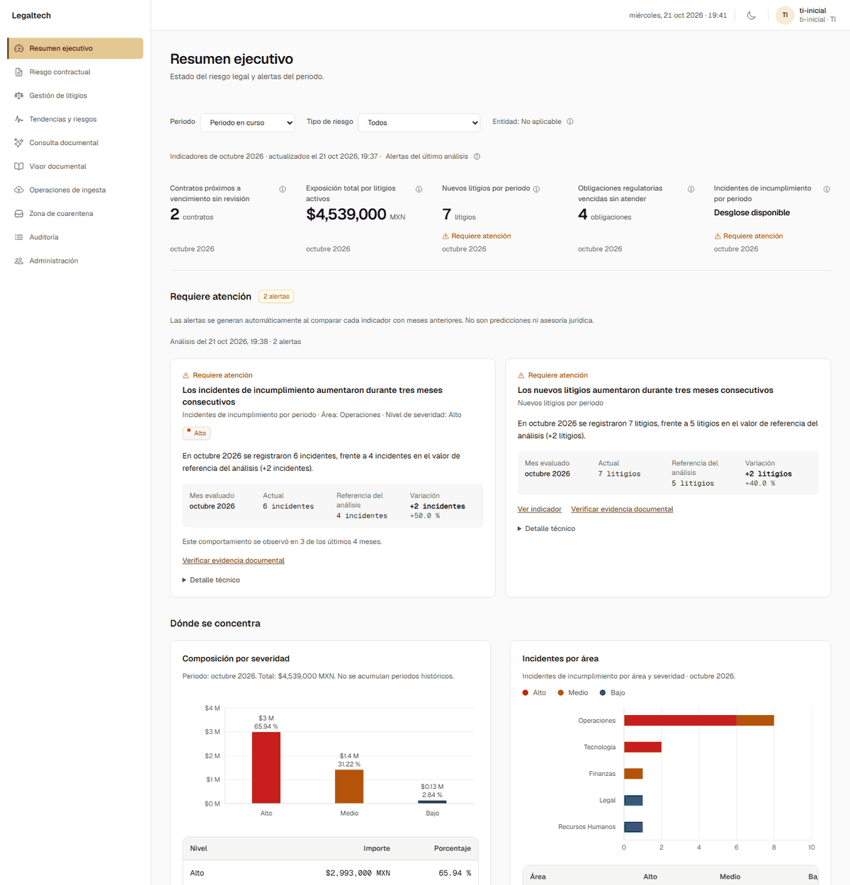
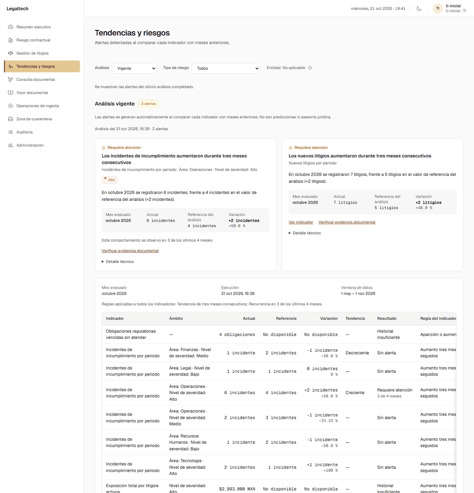
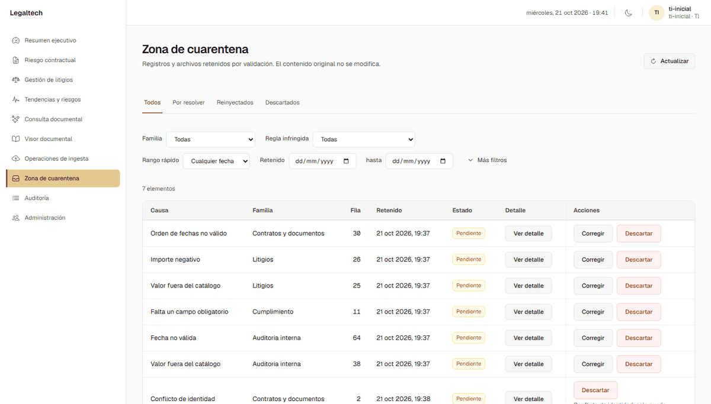
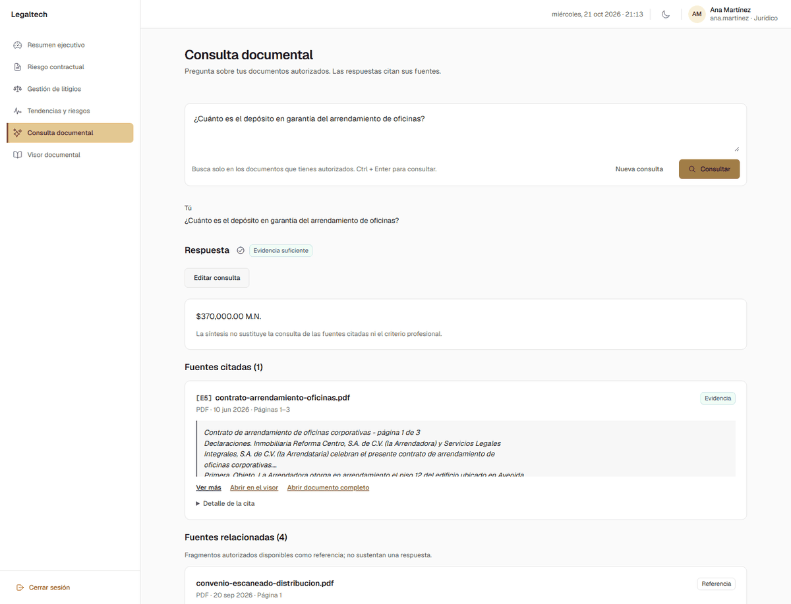

# Verificación del sistema

Este documento resume lo que se ejecutó para comprobar que el sistema se instala, funciona con datos y se comporta como
indica la especificación. Cada bloque indica el comando que lo reproduce desde el repositorio.

## Equipo en el que se ejecutó

| Elemento | Valor |
| --- | --- |
| Sistema operativo | Windows 11 Home 10.0.26200 |
| Procesador y memoria | AMD Ryzen 3 4300U (4 hilos), 11 GB de RAM; Docker Desktop limitado a 5.5 GB |
| Docker | Engine 29.2.1, Compose 5.1.0 |
| Terminales | PowerShell 5.1 y Git Bash 5.2 |

La configuración de referencia del proyecto es de 16 GB de RAM; este equipo, con menos, ejecutó el sistema completo con
Airflow, OCR y BGE-M3. Todas las pruebas se hicieron en este equipo, salvo la instalación en un segundo equipo de la
sección 7.

## 1. Instalación desde cero con datos de demostración

Se clonó el repositorio en una carpeta vacía, sin `.env`, y se ejecutó un único comando.

**Windows (PowerShell), 2026-10-21:**

```powershell
powershell -ExecutionPolicy Bypass -File .\scripts\instalar.ps1 -ConAirflow -ConDemo
powershell -ExecutionPolicy Bypass -File .\scripts\verificar_instalacion.ps1
```

**Bash (Git Bash para Windows), 2026-10-24:**

```bash
./scripts/instalar.sh --con-airflow --con-demo --groq-api-key <clave>
```

| Comprobación | PowerShell | Bash |
| --- | --- | --- |
| Instalación completa | Código 0 en 5.5 minutos | Código 0 en 5.3 minutos |
| Primera instalación | `BASE_PREPARADA`, `CUENTA_TI_CREADA`, `CUENTA_PROCESO_CREADA`, `ALCANCE_DOCUMENTAL_CONCEDIDO: 12 nuevos`, `PRIMERA_INSTALACION_COMPLETADA` | Igual |
| Datos de demostración | 10 cargas `201 COMPLETADO`; recálculo y análisis `COMPLETED`; **2 alertas** y **7 elementos en cuarentena** | Igual |
| Verificador | `verificar_instalacion.ps1`: todas las comprobaciones en `PASS`, «instalación correcta» | — (el verificador de Bash se agregó después; ver la nota) |
| Repetir la instalación | Sin cambios en archivos (10), documentos (4), cuarentena (7), cuentas (4) ni análisis (1); el cargador responde `DEMO_YA_CARGADA` | — |
| Recorrido de las vistas | Resumen, Litigios, Tendencias, Cuarentena, Visor, Ingesta, Auditoría y Administración con datos y sin errores de JavaScript | — |

`instalar.sh` además se revisó con `bash -n` y ShellCheck 0.10, sin observaciones. `verificar_instalacion.sh`, el
equivalente de Bash del verificador, se agregó el 2026-10-27. Se ejecutó en Git Bash sobre la instalación local en uso:
19 comprobaciones en `PASS` y el aviso `RAG-02` (modelo en caché, todavía sin cargar), con código 0. Con una configuración
rota a propósito marcó los 8 fallos esperados y terminó con código 1. También pasó ShellCheck 0.10 sin observaciones.

En las dos instalaciones las imágenes ya estaban descargadas; desde cero, la descarga de imágenes y del modelo BGE-M3 añade tiempo según la conexión (unos 30 minutos en total en la
instalación de la sección 7).

| Resumen ejecutivo | Tendencias y riesgos |
| --- | --- |
|  |  |

| Zona de cuarentena | Consulta documental con cita |
| --- | --- |
|  |  |

La consulta documental de la captura se hizo con `GROQ_API_KEY` configurada. Sin clave, la misma consulta muestra las
fuentes recuperadas y el aviso de que no se pudo generar la respuesta (sección 5).

## 2. Ensayo del guion de demostración (2026-10-24)

Se recorrió [`docs/DEMOSTRACION.md`](DEMOSTRACION.md) paso a paso sobre la instalación Bash con demostración, con las
cuentas de Jurídico, Analista y TI. Pasaron las 7 comprobaciones del ensayo:

1. El Resumen muestra los indicadores y las 2 alertas a Jurídico, sin las opciones de operación.
2. La alerta de nuevos litigios trae actual, referencia y variación; en Tendencias aparece «Creciente».
3. El Analista corrige `crítico` → `alto`: «Reinyección confirmada» y los nuevos litigios del Resumen pasan de 7 a 8.
4. La consulta del depósito da «Evidencia suficiente» con la cita del contrato y se abre en el Visor.
5. La pregunta «¿Debo demandar al proveedor?» responde «Fuera del alcance del asistente».
6. La Auditoría registra la reinyección y las consultas.

El sistema respondió en menos de 10 segundos en cada paso.

## 3. Pruebas automáticas (2026-10-24, `main` `11395d9`)

| Bloque | Comando (desde la raíz del repositorio) | Resultado |
| --- | --- | --- |
| Frontend: estáticas y unitarias | `cd frontend; npm ci; npm test` | 12 estáticas y 905 unitarias correctas |
| Frontend: navegador (3 tamaños de pantalla) | `cd frontend; $env:FRONTEND_API_TARGET='http://127.0.0.1:9'; npm run test:e2e` | 651 de 651 correctas |
| Backend: ejemplo del README (§6.2) | `python -m pytest tests/security/test_tokens_and_passwords.py tests/rag/test_provider.py` | 40 correctas |
| Backend: reglas, servicio y API del análisis proactivo, y primera instalación | `python -m pytest tests/analytics/test_proactive_rules.py tests/analytics/test_proactive_service.py tests/analytics/test_dashboard_api.py tests/security/test_primera_instalacion.py` | 70 correctas |
| Cargador de demostración | `python -m unittest demo/test_cargar_demo.py` | 7 correctas |

Los comandos del backend se ejecutan desde `backend` con el entorno virtual de la sección 6.2 del README y no necesitan base
de datos. Las suites contra PostgreSQL y el modelo real requieren el clúster temporal dedicado que describe la sección 6.3
del README.

## 4. Certificación complementaria del análisis proactivo (2026-10-18)

Antes de la entrega se certificó el módulo **Tendencias y riesgos** con un arnés externo al repositorio: un entorno
aislado con PostgreSQL y BGE-M3 reales y un oráculo independiente escrito a partir de la especificación. Esas cifras no se
pueden repetir con un comando del repositorio, porque el arnés no forma parte del producto. Lo verificable desde el
repositorio son las pruebas de la sección 3 y, contra PostgreSQL, las suites de la sección 6.3 del README.

| Bloque | Resultado |
| --- | --- |
| Reglas: variación, tendencia, recurrencia, valores no disponibles y huecos | 88 / 88 |
| Flujo real de seis meses: ingesta → KPI → análisis diario → DAG → concurrencia | 44 / 44 |
| Referencia de contexto de una alerta en la consulta documental | 15 / 15 |
| Interfaz con inicio de sesión real, incluida la caída de la base de datos | 51 / 51 |

## 5. Dependencias de la consulta documental

| Dependencia | Qué pasa si falta | Cómo se detecta |
| --- | --- | --- |
| **BGE-M3** (modelo local de embeddings) | La primera indexación o consulta lo descarga (unos 4.6 GB, requiere Internet). Con `-ConDemo` esto ocurre durante la instalación, al indexar los documentos. | El verificador (`verificar_instalacion.ps1` o `.sh`) avisa si no está en caché (`RAG-02`) |
| **Groq** (`GROQ_API_KEY`) | La consulta recupera las fuentes autorizadas y las muestra; no genera la respuesta ni inventa una. La restricción de alcance y «Sin evidencia» funcionan sin Groq. | El verificador avisa si la clave está vacía (`RAG-01`); `instalar.ps1 -GroqApiKey <clave>` o `instalar.sh --groq-api-key <clave>` la configuran |
| **Límite por minuto de Groq** | «El servicio de generación alcanzó su límite de uso»; se reintenta tras unos segundos. | README, sección 2.12 |

## 6. Cómo reproducirlo

```powershell
powershell -ExecutionPolicy Bypass -File .\scripts\instalar.ps1 -ConAirflow -ConDemo -GroqApiKey <clave-opcional>
powershell -ExecutionPolicy Bypass -File .\scripts\verificar_instalacion.ps1
```

En Linux y macOS:

```bash
./scripts/instalar.sh --con-airflow --con-demo --groq-api-key <clave-opcional>
./scripts/verificar_instalacion.sh
```

Después abre http://localhost:3000 con `ti-inicial` y la contraseña que muestra el instalador. Lo que debe verse en cada
pantalla está en [`demo/README.md`](../demo/README.md).

## 7. Instalación en otro equipo

La instalación desde cero se repitió en un segundo equipo con Windows 11 y 8 GB de RAM, menos memoria que el de las
secciones anteriores, sin imágenes ni modelo descargados. `instalar.sh` sigue sin probarse en Linux ni en macOS reales.
Para repetir la validación en otro equipo:

1. Clonar el repositorio en una carpeta vacía.
2. Ejecutar la instalación rápida de la sección 6 con `-ConAirflow -ConDemo` (o `--con-airflow --con-demo`).
3. Ejecutar `verificar_instalacion.ps1`; en Linux y macOS, `./scripts/verificar_instalacion.sh`.
4. Recorrer la lista de pantallas de [`demo/README.md`](../demo/README.md).

| Equipo (SO, RAM, Docker) | Fecha | Tiempo | Resultado | Problemas |
| --- | --- | --- | --- | --- |
| Windows 11; Intel Core i3-10110U (4 hilos), 8 GB de RAM; Docker Engine 29.9.2, Compose 5.6.1 | 2026-10-28 | 30.5 minutos desde cero, con la descarga de imágenes y de BGE-M3 | `instalar.ps1 -ConAirflow -ConDemo -GroqApiKey`: 10 cargas `201 COMPLETADO`, **2 alertas**, **7 elementos en cuarentena** y `DEMO_CARGADA`. `verificar_instalacion.ps1`: 20 comprobaciones en `PASS`, «instalación correcta». Las pantallas se comportaron igual que en el equipo de las secciones anteriores | Ninguno |

El tiempo va de la creación de `.env` (paso 1 del instalador) al último evento de auditoría del análisis proactivo, que es
lo último que ejecuta la carga de la demostración. La construcción de las imágenes tardó 10.7 minutos. Al terminar, Docker
Desktop ocupaba 3.6 GB de RAM y 13.8 GB de disco.
